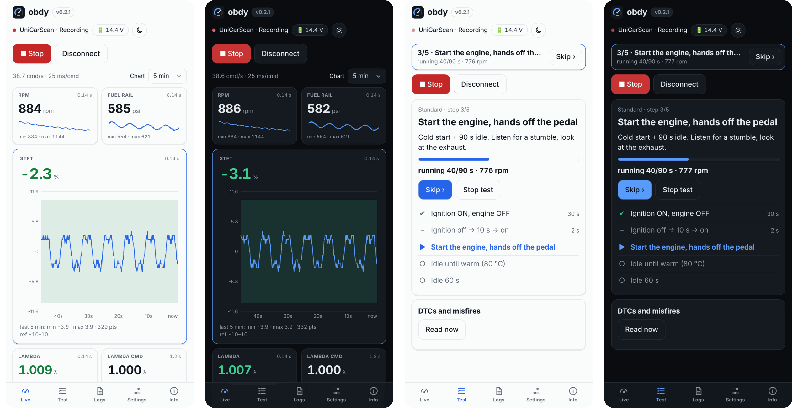

# obdy

**Your phone as a car scanner.** Plug a Bluetooth OBD-II adapter into the car, open the page and see live engine
data, trouble codes and misfires, run a guided test, and keep a log you can share with a mechanic.
No app to install, no account, all data stays on your phone.

**[▶ Open obdy](https://artyrian.github.io/obdy/)** · try **Demo** without a car

  
   Live data with a chart and its normal range · guided test step by step · light and dark themes

## What it does

- **Live dashboard.** RPM, fuel rail pressure, fuel trims, lambda, coolant, battery and more, each with a mini chart.
  Tap a tile for a full chart.
- **Knows your car.** Reads the VIN, detects make, model and year, and loads the car's manufacturer values
  from the community database [OBDb](https://github.com/OBDb), e.g. low-side fuel pressure or misfire per cylinder
  on a Mustang. Pick more in Settings; values the car doesn't answer are skipped.
- **Normal ranges.** A green band shows what's normal right now (engine off, warming up, idle).
  Values outside it turn orange or red.
- **Trouble codes and misfires.** Codes straight from the engine module with their status (like dealer tools),
  plus OBD stored/pending/permanent codes, freeze frame and misfire counts per cylinder.
- **Guided tests.** Step-by-step checklist that tells you what to do and moves on by itself:

  | Test | Time | Steps |
  |---|---|---|
  | Quick | ~2 min | ignition on → start → idle |
  | Standard | ~10 min | cold start: two fuel primes → start → warm-up → idle |
  | Full | ~13 min | Standard + 2500 rpm hold and throttle snaps |
  | Drive | any | a drive with codes checked before and after |

- **Recording.** Starts when you connect. Codes and misfires are checked every 20 s.
  Logs are compact and saved on the phone; share them as a file in one tap.
- **Settings.** Pick which values to read and how often. Light and dark themes.

## Get started

1. Get a **Bluetooth LE (BLE) ELM327 adapter**, e.g. UniCarScan UCSI-2100, Veepeak BLE, Vgate iCar Pro BLE.
2. Open **[artyrian.github.io/obdy](https://artyrian.github.io/obdy/)**:
   - **iPhone:** in **[Bluefy](https://apps.apple.com/app/id1492822055)** (Safari and Chrome on iOS can't use Bluetooth);
   - **Android, Mac, Windows:** in Chrome or Edge.
3. Turn the **ignition on**, tap **Connect adapter** and pick the adapter.

## Tips

- **Close other OBD apps** (Car Scanner, etc.): an adapter talks to one app at a time.
- **Keep the page on screen.** The phone pauses background pages, and the adapter disconnects after a few minutes.
  While recording the screen stays on, so plug the phone in for long sessions.
- **"Low Data Mode" warning** in Bluefy is harmless: the page needs internet only to open.
- **Something went wrong?** Tap **Copy log** on the red banner and send it along with your issue.

## Compatibility

Built and tested on a **Ford Mustang 2.3 EcoBoost**. Standard OBD-II (live data, codes, freeze frame) works on most
cars from 2008 on, and manufacturer values work wherever OBDb has a profile for the car. Some parts are tuned for Ford
and may not fit other makes: misfire counters, normal ranges and guided-test thresholds.
obdy is a diagnostic aid, not a replacement for a professional scan tool.

Manufacturer values: [OBDb](https://github.com/OBDb) (CC BY-SA 4.0). VIN decoding: NHTSA vPIC.

---

Developers: see [docs/DEVELOPMENT.md](docs/DEVELOPMENT.md).
